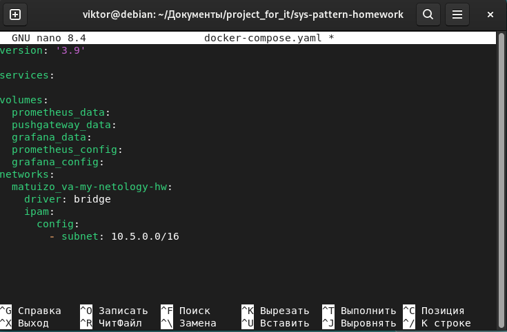
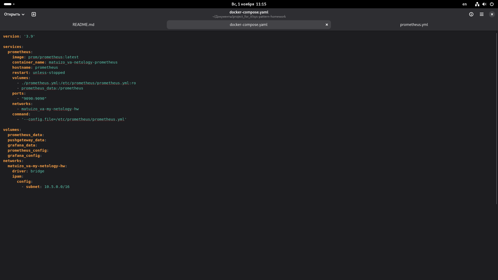
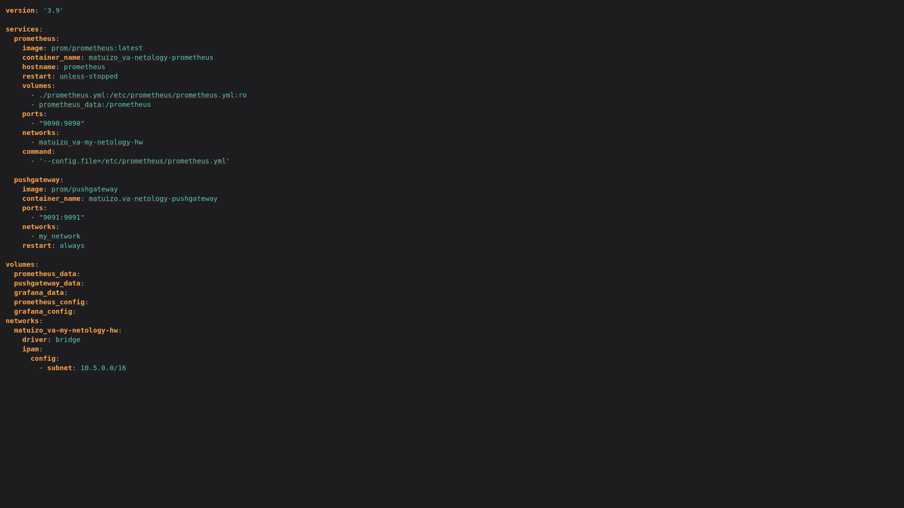
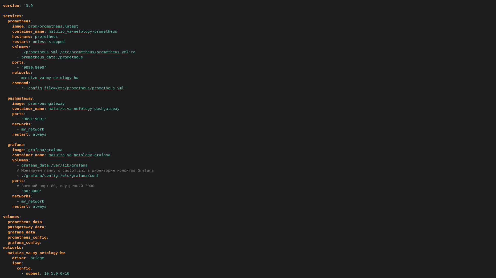
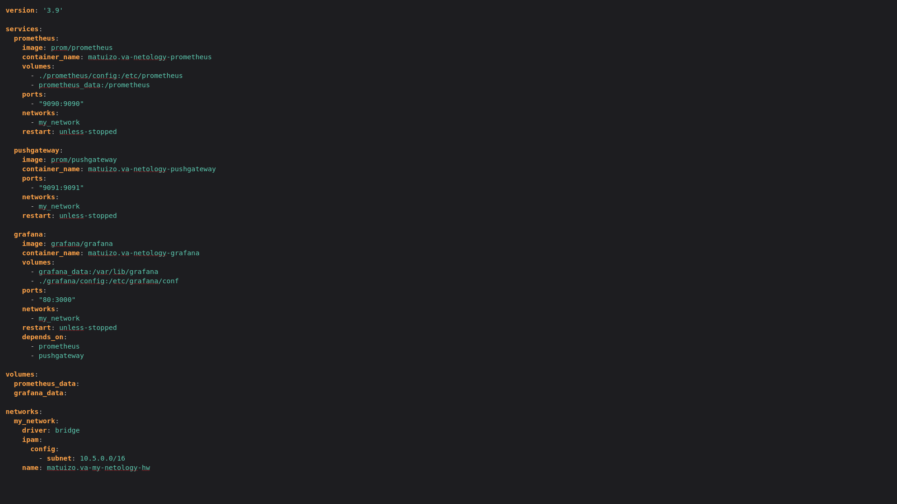
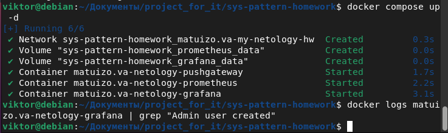
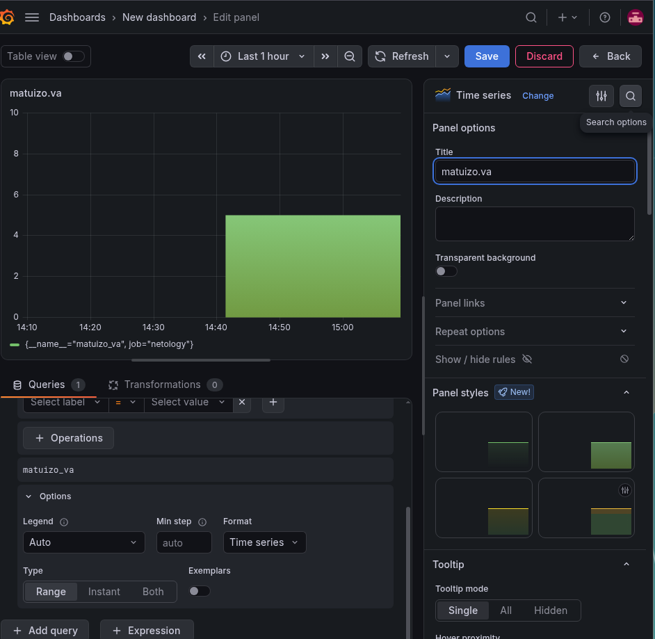
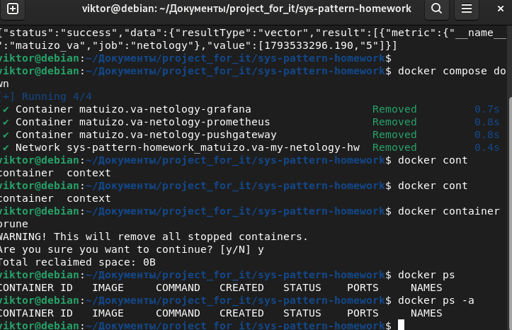

# Docker_part_2 — Matuizo Viktor

## Описание
Это домашнее задание по работе с Docker Compose и мониторингом. В рамках работы настроен мультиконтейнерный стек для Prometheus, Pushgateway и Grafana.

**Docker Compose** — инструмент для декларативного описания и запуска мультиконтейнерных приложений. Он позволяет в одном файле `docker-compose.yml` задать все сервисы, сети, тома, зависимости и параметры запуска, а затем развернуть всю инфраструктуру одной командой. Это делает окружение воспроизводимым и одинаковым у всех участников команды, снижая риск ситуации «у меня на машине всё работает».

---

## Выполненные задачи

### Задание 2. Базовая конфигурация Docker Compose
Создан файл `docker-compose.yml` с первичными настройками: указаны `version`, блоки `services`, `volumes`, `networks`. Настроена пользовательская сеть с подсетью `10.5.0.0/16` и именем `matuizo.va-my-netology-hw`.


*Рис. 1. Скриншот к заданию 2.*

### Задание 3. Настройка Prometheus
Настроена конфигурация для Prometheus:
- Сервис с именем контейнера:  `matuizo.va-netology-prometheus`
- Подключены тома с данными и конфигурацией из директории: `6-04/prometheus`
- Внешний доступ к порту: `9090`


*Рис. 2. Скриншот к заданию 3.*

### Задание 4. Настройка Pushgateway
Настроена конфигурация для Pushgateway:
- Сервис с именем контейнера: `matuizo.va-netology-pushgateway`
- Внешний доступ к порту: `9091`


*Рис. 3. Скриншот к заданию 4.*

### Задание 5. Настройка Grafana
Настроена конфигурация для Grafana:
- Сервис с именем контейнера: `matuizo.va-netology-grafana`
- Подключены тома с данными и конфигурацией из директории: `6-04/grafana`
- Добавлена переменная окружения с путём до файла кастомных настроек
- В файле заданы логин: `matuizo.va` и пароль: `netology`
- Настроен доступ к порту `3000` через порт `80` докер-сервера


*Рис. 4. Скриншот к заданию 5.*

### Задание 6. Зависимости, перезапуски и запуск
Настроены зависимости и порядок запуска контейнеров, режимы перезапуска, все сервисы объединены в одну сеть. Сценарий запущен в detached-режиме.


*Рис. 5. Скриншот к заданию 6.*

### Задание 7. Работа с метриками и визуализация
Выполнены следующие действия:
- Отправлена метрика `matuizo_va` со значением `5` в Pushgateway
- Выполнен вход в Grafana по заданным учётным данным
- Создан Data Source для Prometheus
- Построен график на основе добавленной метрики

Приложены: полный `docker-compose.yml`, скриншот `docker ps`, скриншот графика.

#### Вывод команды `docker ps`

*Рис. 6. Вывод команды docker ps.*

#### График метрики в Grafana

*Рис. 7. График метрики в Grafana.*

### Задание 8. Остановка и удаление контейнеров
Контейнеры остановлены и удалены одной командой.


*Рис. 8. Скриншот остановки и удаления контейнеров.*

---

## Как запустить проект

1. Убедитесь, что Docker и Docker Compose установлены.
2. Перейдите в директорию с проектом.
3. Запустите стек в detached-режиме:
   ```bash
   docker compose up -d
